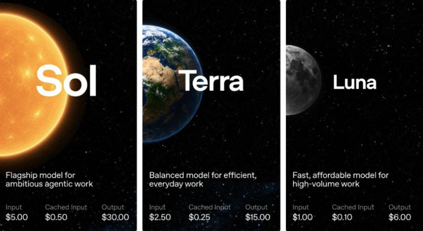

And one thing immediately clicked for me: **cached input is 90% cheaper than normal input.**

At first, this looks like a pricing detail: *"Nice, cheaper tokens."*

But I think the bigger signal is **architectural**.

If repeated context is dramatically cheaper, then the way we design LLM applications and agentic workflows has to change.

Because in real system design, we repeat a lot of context:

- System instructions
- Tool definitions
- Output schemas
- Safety rules
- Few-shot examples
- Domain-specific guidelines
- Agent loop instructions
- Retrieved summaries

Most AI engineers still treat context like a temporary message payload:

1. Build prompt.
2. Send prompt.
3. Get answer.
4. Repeat.

But production AI workflows are not random chat sessions.

They have repeated workflows, repeated tools, repeated rules, and repeated domain logic. So the real question becomes:

> **"Can your system separate stable context from dynamic context?"**

Because cached input rewards that discipline. This is why I think **prompt engineering is slowly becoming context engineering**.

Not just: *"Write a better prompt."*

More like: **Design the lifecycle of context!**

- What should be **reused**?
- What should be **retrieved**?
- What should be **compressed**?
- What should be **dynamic**?
- What should **never enter the prompt at all**?

The cheapest token is not always the token you remove.

**Sometimes it's the token you reuse intelligently!**

