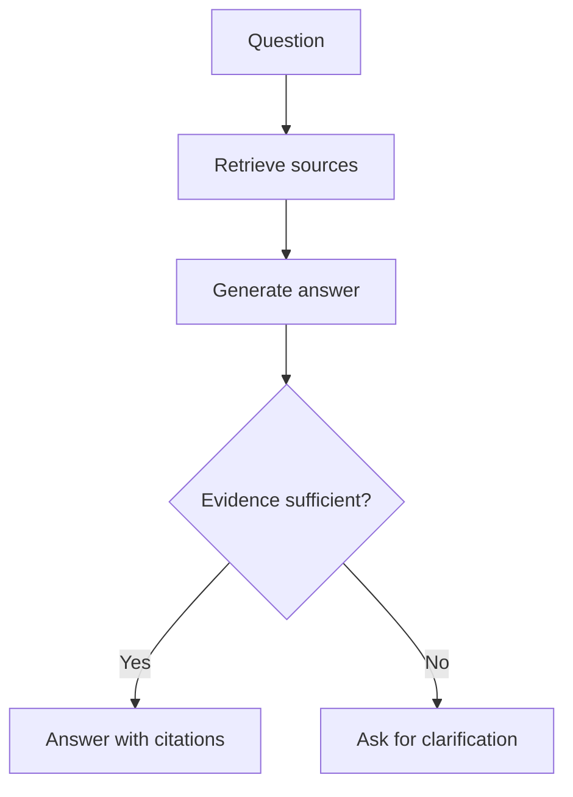

Write the introduction here. Copy this file to `content/articles/`, set a unique slug and date, and change `draft` to `false` when ready.

## The problem

Explain the problem in your own words.

## An image


## An architecture diagram



## Code

```python
def answer(question: str) -> str:
    return "Replace this example with your code."
```

## Results

| Measure | Before | After |
| --- | --- | --- |
| Your measure | Value | Value |

## What I learned

Add your conclusion and references.
